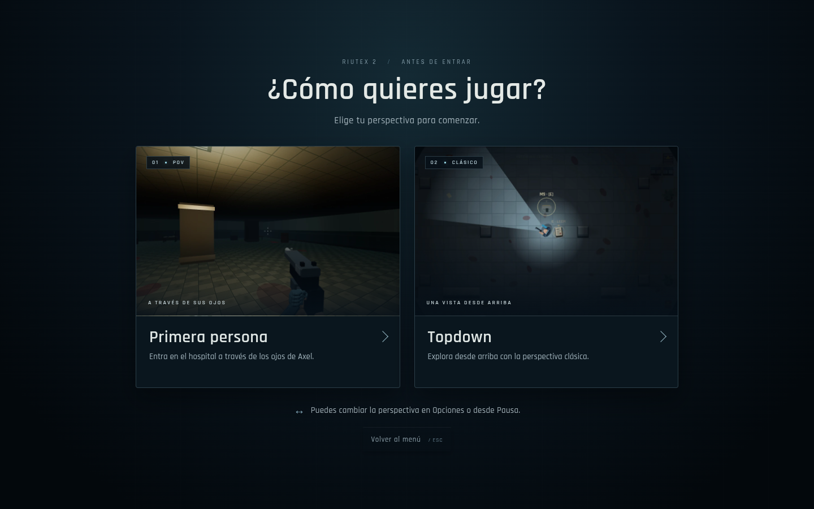

# Elegir perspectiva · v0.23.0

**Nueva partida** muestra la pregunta y dos tarjetas con capturas locales de la misma zona del hospital: Primera persona y Topdown. Debajo de cada imagen están el nombre y una descripción breve. El aviso inferior recuerda que la vista se puede cambiar desde los ajustes.

Un clic o Enter sobre una tarjeta elige la perspectiva y comienza la mansión, con fundido. La elección conserva la activación del usuario para capturar el ratón en POV; topdown lo mantiene libre. Escape o Volver al menú cancela sin iniciar una partida. Tab recorre las dos tarjetas y Volver; las flechas cambian de tarjeta. El foco inicial recuerda la preferencia actual, sin elegir automáticamente por el jugador.

La ventana usa el estado de menú: no avanza enemigos, recursos ni guardado periódico. Continuar sesión, cargar una camilla y Reintentar mantienen el flujo directo. La preferencia sigue siendo la misma opción de POV existente, separada de las partidas; puede cambiarse en Opciones o Pausa. Si el navegador no puede iniciar WebGL se mantiene el respaldo clásico existente.

En pantalla grande se muestran dos columnas; en pantalla estrecha se apilan y la ventana permite desplazarse. Las imágenes se empaquetan dentro del HTML integrado, sin peticiones externas ni render extra mientras se elige.

## Movimiento de cámara

El POV añade oscilación vertical y una inclinación lateral muy pequeña sincronizadas con los pasos. La amplitud máxima es de 0,5 unidades al caminar y 0,82 al correr, frente a casillas de 32 unidades y un ojo a 35. La inclinación es de hasta aproximadamente 0,19 grados. La entrada y la salida se suavizan; no permanece un desplazamiento al detenerse.

Se basa en desplazamiento real e intención de caminar: empujar una pared, esconderse o recibir desplazamiento sin caminar no simula pasos. Pausar conserva la pose; Reducir movimiento elimina el efecto. Topdown no usa este sistema. La inclinación es alrededor del eje de visión, sin girar el apuntado; la simulación de disparos y la cámara consultan la misma altura del ojo.

## Validación

La suite de navegador usa clics y teclado reales, captura nativa y fundido completo. Comprueba imágenes, cancelación, carga de sesión, elección explícita frente a una preferencia anterior, ajustes y tamaños de 1440, 1280 y 390 píxeles. El movimiento se comprueba con física real en un suelo preparado: amplitud, centrado, alineación del disparo y reducción de movimiento. La suite de motor cubre además pausa, pared, ocultación, sprint y reinicio. Los recuentos finales se registran en VALIDACION.md y RESULTADOS.json.
